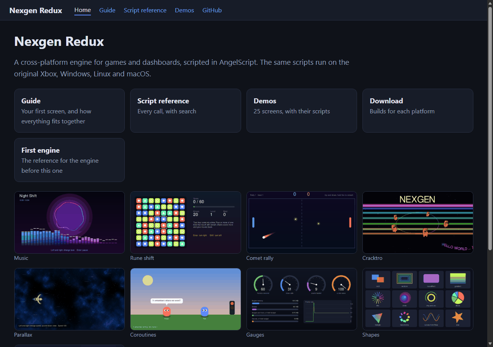
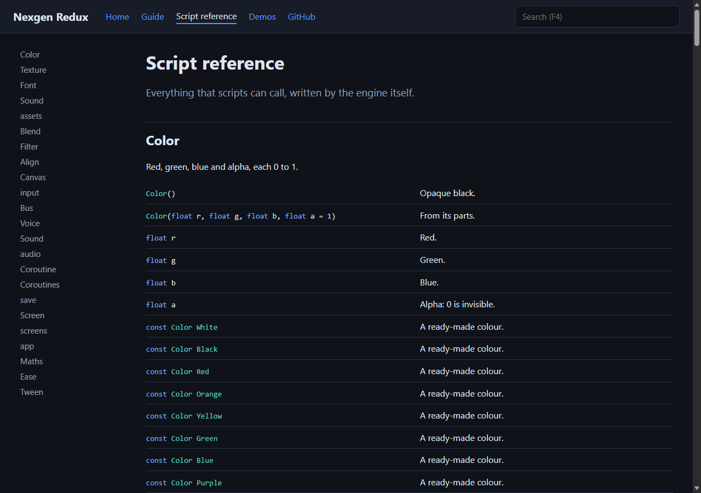

<h1 align="center">NexgenRedux-Docs</h1>

<p align="center"><b>The documentation for Nexgen Redux</b></p>

<p align="center">
  <a href="https://team-resurgent.github.io/NexgenRedux-Docs/"></a>
  <a href="https://discord.gg/VcdSfajQGK"></a>
</p>

<p align="center">
  <a href="https://ko-fi.com/J3J7L5UMN"></a>
  <a href="https://www.patreon.com/teamresurgent"></a>
</p>

The web site for [Nexgen Redux](https://github.com/Team-Resurgent/NexgenRedux): a guide, a searchable script reference, and
every demo with its whole script. The reference for the first engine is kept under `v1`.

**Read it at [team-resurgent.github.io/NexgenRedux-Docs](https://team-resurgent.github.io/NexgenRedux-Docs/).**

<p align="center">
  <a href="https://team-resurgent.github.io/NexgenRedux-Docs/"></a>
  <a href="https://team-resurgent.github.io/NexgenRedux-Docs/reference.html"></a>
</p>

## What is where

| Page | What it is | Made from |
|---|---|---|
| `index.html`, `guide.html` | Home and the guide | `docs/Guide.md` in NexgenRedux |
| `reference.html` | Everything that scripts can call | `docs/ScriptReference.md`, which the engine writes |
| `demos.html` | Every demo and its script | `engine/media/showcase` |
| [`v1/index.html`](https://team-resurgent.github.io/NexgenRedux-Docs/v1/) | The first engine's reference | Kept as it was |

Press **F4** to search. The pages need no server: clone the repository and open `index.html`.

## Updating it

The new pages are generated, so change what they are made from, not the pages. In NexgenRedux, with this repository as its
submodule:

```powershell
showcase --docs docs/ScriptReference.md
```

```powershell
python engine/tools/make_docs.py NexgenRedux-Docs
```

## Related repositories

| Repository | What it is |
|---|---|
| [NexgenRedux](https://github.com/Team-Resurgent/NexgenRedux) | The engine |
| [NexgenRedux-Media](https://github.com/Team-Resurgent/NexgenRedux-Media) | An example game |
