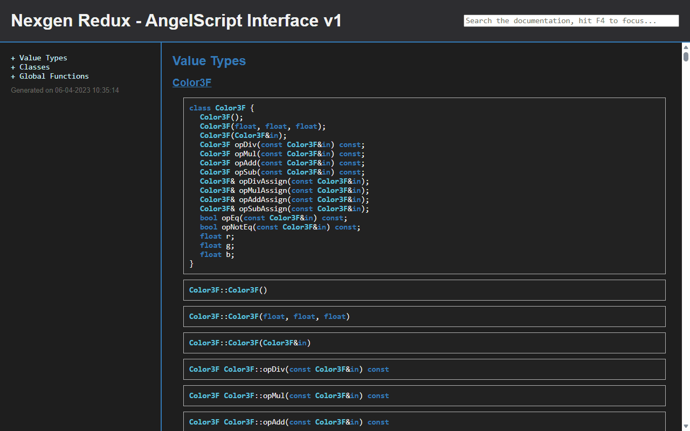

<h1 align="center">NexgenRedux-Docs</h1>

<b>The AngelScript reference for Nexgen Redux</b>

  
  

  
  

Every type, method and function that scripts can use in the first
[Nexgen Redux](https://github.com/Team-Resurgent/NexgenRedux) engine, on one searchable page.

**Read it at [team-resurgent.github.io/NexgenRedux-Docs](https://team-resurgent.github.io/NexgenRedux-Docs/).**

  

## Using it

- Press **F4** to search.
- To read it offline, clone this repository and open `index.html`. It is a single file; only jQuery is fetched from the web.

## Which engine this is for

| Engine | Reference |
|---|---|
| The first engine (`NexgenRedux-Shared`, `-PC`, `-OG`, `-360`, `-UWP`) | This repository |
| The new engine (`engine/`) | [docs/ScriptReference.md](https://github.com/Team-Resurgent/NexgenRedux/blob/main/docs/ScriptReference.md), written by the engine itself |

## Related repositories

| Repository | What it is |
|---|---|
| [NexgenRedux](https://github.com/Team-Resurgent/NexgenRedux) | The engine |
| [NexgenRedux-Media](https://github.com/Team-Resurgent/NexgenRedux-Media) | An example game |
